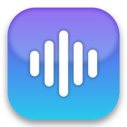
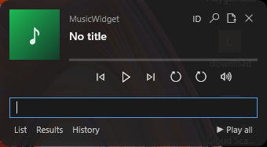
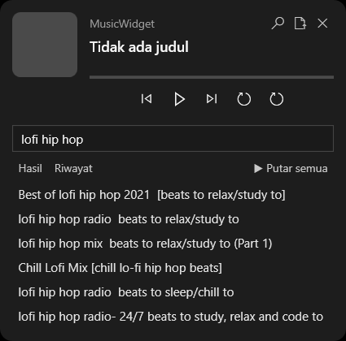
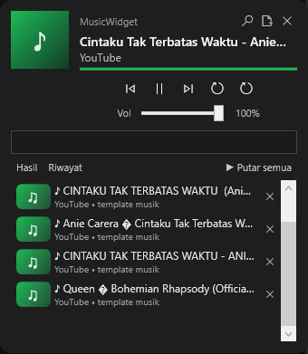

<div align="center">



# 🎵 Simple Music Widget

**A tiny, futuristic now-playing overlay for Windows.**
One widget controls *everything* — YouTube & Spotify in your browser, VLC, Windows Media Player, and more.


</div>

The GIF shows the real Windows app with an original local demo track. It is silent; the charcoal–green backdrop is presentation artwork, not a change to the widget UI.

Social-video sources and Indonesian captions: [`videos/music-widget-demo/`](videos/music-widget-demo/README.md).

---

## ✨ Why this widget?

Most "now playing" widgets only work with one app. This one reads Windows **System Media Transport Controls (SMTC)** — the same layer the OS uses for its taskbar media flyout — so it shows and controls **whatever you're playing**, from any app, with a single tiny window. It also adds its own **built-in YouTube audio player** (search & play without opening a browser).

- 🪶 **Lightweight** — ~85 MB working set, single small `.exe`, no heavy frameworks.
- 🌐 **Bilingual UI** — English by default with a compact `ID/EN` toggle saved between sessions.
- 📰 **Auto-scrolling track text** — long titles and artist names scroll smoothly from right to left so the full text remains readable.
- 🎛️ **Universal control** — prev / play-pause / next + live progress bar for any source.
- 🔊 **Hideable widget volume slider** — adjust the widget-owned local/YouTube player volume safely, then hide it to keep the overlay minimal.
- 📁 **Broad local media support** — play common audio/video containers (`mp3`, `mp4`, `mkv`, `webm`, `flac`, `ogg`, and more) by extracting audio when needed.
- 🔎 **YouTube search & play (audio only)** — no browser needed, with clean music-template previews and a hideable results/history list.
- 🕘 **History** — past searches autocomplete; played tracks are saved and replayable.
- ▶️ **Play all** — queue an entire result list or your history (auto-advances).
- 🔁 **Repeat & Loop** — replay the last track, or loop the current one forever.
- 🗑️ **One-tap delete** — remove any history item with its little ✕.
- 🚀 **Auto-start + optional auto-show**: runs at boot and appears when music plays, unless you explicitly Hide or Minimize it.
- 🙈 **Hide, Minimize, restore, and resize**: Hide/Minimize stays in the tray until an explicit summon. Resize horizontally with either edge grip; expand/restore preserves your previous width and dragged position.
- 🔔 **Update notifications** — checks GitHub Releases and notifies when a new app version is available.

---

## 📸 Screenshots

| Compact widget | YouTube search & results | Volume + template preview |
|---|---|---|
|  |  |  |

---

## ▶️ Demo (how it works)

1. **Play music anywhere** — YouTube in Chrome/Edge, Spotify, VLC, Windows Media Player. The widget pops up at the bottom-right with the title, artist, artwork, and working controls.
2. **Open local media** — click the file button and choose common audio/video media (`mp3`, `mp4`, `mkv`, `webm`, `flac`, `ogg`, etc.). Video containers are played as audio.
3. **Search YouTube** — click 🔎, type a song, press Enter. Pick a result to play its audio right inside the widget (no browser).
4. **Use volume safely** — click the volume icon only when needed, move the **Vol** slider, then hide it again for a compact widget.
5. **Read long tracks** — long titles and artist names automatically marquee from right to left when they do not fit.
6. **Play all** — hit **▶ Play all** to queue the whole list; it auto-advances track to track.
7. **History**: use **List** to show/hide the list and switch with **Results** / **History**. Results retains the latest completed search independently of history and autocomplete suggestions.
8. **Repeat / Loop** — 🔁 replays the last track; the loop button repeats the current one endlessly.
9. **Hide / Unhide** — click ✕ to hide the widget and stop automatic popups while media keeps playing. Use the tray icon or launch shortcut again to Unhide.
10. **Minimize / Expand**: use `_` to hide to the tray until you summon the widget again. The expand button widens the widget; toggling it again restores the previous width.
11. **Switch language** — click the tiny `ID/EN` button to switch between English and Indonesian.
12. **Delete** — click the small ✕ on any history row to remove it.

Drag the left or right edge grip to resize horizontally. A minimum width keeps window and playback controls reachable, and the current monitor's work area bounds the width. Focus a grip and use Left/Right arrows for keyboard resizing. Search and volume panels still determine the height automatically.

Local/YouTube playback owns the displayed title, source, and progress until it finishes or stops; unrelated SMTC events cannot replace that metadata.

---

## 🚀 Install (Windows)

**For normal users:** Windows 10/11. The release installer is self-contained and does not require a separate .NET install.

**For YouTube playback:** install `yt-dlp` and `ffmpeg` from trusted package managers:

```powershell
winget install yt-dlp.yt-dlp Gyan.FFmpeg
```

**For developers:** install the .NET 8 SDK:

```powershell
winget install Microsoft.DotNet.SDK.8
```

### Recommended: Windows installer `.exe`

Download `MusicWidgetSetup-*-win-x64.exe` from [**Releases**](https://github.com/Wayan123/Simple-Music-Widget/releases/latest), run it, then launch **Music Widget** from the Start Menu.

Release installers are self-contained for Windows x64, so users do not need to install the .NET Desktop Runtime separately. The installer is per-user (no admin required), adds a Start Menu shortcut, supports uninstall from Windows Settings, and can optionally add Desktop/Startup shortcuts when built with Inno Setup.

Verify downloads with the `SHA256SUMS.txt` file attached to each release.

> Note: builds are currently unsigned until a code-signing certificate is available, so Windows SmartScreen may show a warning.

### Developer one-click setup

```powershell
git clone https://github.com/Wayan123/Simple-Music-Widget.git
cd Simple-Music-Widget
powershell -ExecutionPolicy Bypass -File install.ps1
```

`install.ps1` stops any old running widget first, builds the app, adds a **Startup** shortcut (auto-run at boot), a **Start Menu** shortcut (right-click → *Pin to taskbar*), and launches it.

### Build release artifacts

```powershell
powershell -ExecutionPolicy Bypass -File scripts/build-installer.ps1 -SelfContained
```

This publishes the app, copies `LICENSE`/`README.md` into the payload, creates a portable ZIP, builds an installer `.exe`, and writes a SHA256 checksum file. If Inno Setup is unavailable locally, the script falls back to a no-admin IExpress installer.

### Or just run

```powershell
dotnet run -c Release
```
### Regression checks (Windows)

```powershell
powershell -NoProfile -File scripts/regression-window-controls.ps1
```

The default suite exercises real WPF windows, native geometry, button hit targets, both resize grips, repeated minimize/restore, metadata precedence, stale search completions, and Results/History transitions. It does not run the normal startup path, contact YouTube, alter saved preferences/history, signal an existing widget instance, or stop other processes. CI and the release workflow run this suite before packaging.

For an interactive Windows session with SMTC and media playback available:

```powershell
powershell -NoProfile -File scripts/regression-window-controls.ps1 -IncludePlayback
```

This additionally plays temporary synthetic silent WAV files in an owned player, checks track identity and volume across source changes, and cleans up its player/files. It briefly publishes a test SMTC session. Use `-Suite Window` or `-Suite Presentation` to select the offline suites, and `-SnapshotDirectory <path>` for screenshots containing only fixture data.

### Unreleased fixes

- Minimize-to-tray no longer mixes native minimized state with hidden state, and media events cannot undo explicit Hide/Minimize.
- Window actions use a full-width header; minimum width and bounded horizontal grips prevent clipped controls.
- Expand/restore retains custom width and position, including the opposite edge at the maximum resize limit.
- Owned playback metadata is updated directly after loading instead of depending on SMTC feedback.
- Results, History, suggestions, loading, and errors have separate state; tab/language changes no longer discard results or replace history with a late response.
- Source changes preserve volume because WPF `MediaPlayer.Close()` resets its native volume to 50%.

An already-running widget is not hot-reloaded by a build. Exit that instance through the tray's **Keluar** menu before launching `bin\Release\net8.0-windows10.0.19041.0\MusicWidget.exe`; launching another copy while it is running only summons the existing instance.


---

## 🧠 How it stays "one widget for all"

It does **not** talk to YouTube/Spotify directly for control. It reads **SMTC** (`Windows.Media.Control.GlobalSystemMediaTransportControlsSessionManager`), the central layer every modern media app reports to. For its own YouTube player, `yt-dlp` resolves the audio stream and `ffmpeg` bridges it into a local file that WPF `MediaPlayer` plays (WPF can't open googlevideo URLs directly).

> ⚠️ Playing YouTube audio outside a browser is against YouTube's ToS and can break when YouTube changes. Keep `yt-dlp` and `ffmpeg` updated through your package manager, for example `winget upgrade yt-dlp.yt-dlp Gyan.FFmpeg`.

---

## 🔒 Privacy and local data

Music Widget stores lightweight local preferences/history only on your machine:

- YouTube search history and played-track history: `%AppData%\\MusicWidget`
- Language preference: `%AppData%\\MusicWidget\\language.txt`
- Installed app files, when using the installer: `%LocalAppData%\\Programs\\MusicWidget`

The app does not upload history to any service. YouTube search/playback uses your locally installed `yt-dlp` executable.

---

## 🗂️ Project structure

| File | Role |
|------|------|
| `MediaService.cs` | SMTC wrapper: read active session, snapshot, prev/play/next |
| `LocalPlayer.cs` | MediaPlayer for local files & YouTube (ffmpeg bridge), loop, queue events |
| `YouTubeService.cs` | yt-dlp search + audio-URL resolve; yt-dlp/ffmpeg path resolve |
| `HistoryStore.cs` | JSON persistence for searches & played tracks |
| `UpdateService.cs` | GitHub Releases version checker |
| `TrayIcon.cs` | System-tray icon (hide / unhide / exit) |
| `App.xaml.cs` | Single-instance entry point (summons running instance) |
| `MainWindow.xaml(.cs)` | UI overlay, search/history, queue, repeat/loop, auto show-hide |
| `install.ps1` | Developer publish + Startup/Start-Menu shortcuts + yt-dlp update |
| `scripts/build-installer.ps1` | Release artifact builder: portable ZIP + installer `.exe` |
| `scripts/regression-window-controls.ps1` | Isolated WPF/native window and presentation regression runner; optional real playback smoke |
| `tests/MusicWidget.Regression.csproj` | Windows regression executable with synthetic fixtures and no personal singleton interaction |
| `installer/MusicWidget.iss` | Inno Setup installer definition |
| `.github/workflows/ci.yml` | PR/main build and publish smoke test |
| `.github/workflows/windows-release.yml` | CI workflow for installer artifacts and tag releases |
| `make_icon.py` | Generates the futuristic 3D icon |

---

## 📦 Releasing a new version (maintainer)

1. Bump `<Version>` in `MusicWidget.csproj`.
2. Open a PR and verify CI passes.
3. Merge, tag, and push. The tag must match the project version:
   ```powershell
   git tag -a vX.Y.Z -m "vX.Y.Z"
   git push origin vX.Y.Z
   ```
4. GitHub Actions builds `MusicWidgetSetup-*-win-x64.exe`, the portable ZIP, and `SHA256SUMS.txt`, then attaches them to the GitHub Release.
5. Running widgets detect the new release and show a tray notification.

---

## 🐧 Linux?

Not yet. The widget is built on Windows-only tech (SMTC + WPF). A Linux version would need a separate app (MPRIS/D-Bus + GTK/Qt) and is planned as a future, separate project.

---

## 📄 License

MIT — free to use, modify, and share.
